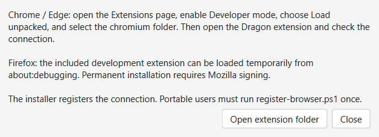
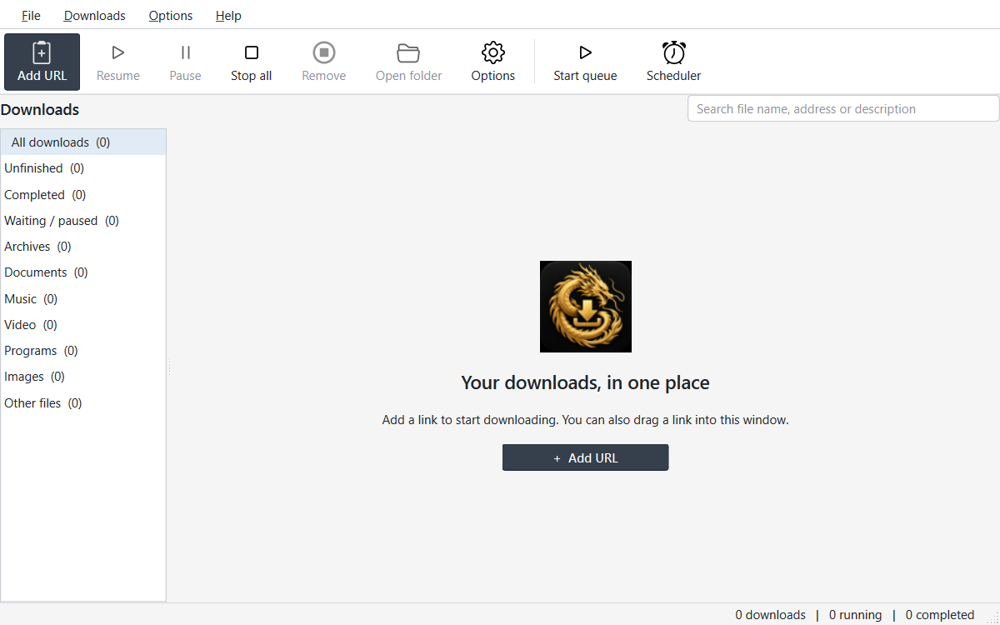
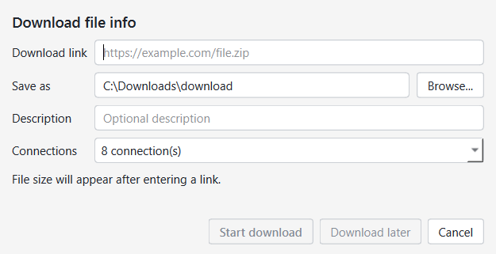

# Dragon Download Manager

A C++ / Qt 6 download manager by **Brami Group**. Gold and charcoal branding, a readable light theme, and a direct desktop download workflow.

[Website](https://mobile-dragon.net/) · [Windows releases](https://github.com/ammarsh90/dragon-download-manager/releases)

## 1.3 preview

Dragon Browser Integration adds direct download capture for Chrome / Edge and a Firefox development add-on. Install the extension once using the [browser setup guide](docs/BROWSER_INTEGRATION.md). The app and native host were built; browser end-to-end checks have not been run, so this remains a preview.

## Download workflow

1. Choose **Add URL**, paste a direct HTTP/HTTPS link, and choose the full file name.
2. Select **1, 2, 4, 8 or 16** connections, then **Start download** or **Download later**.
3. A separate progress window shows the file, size, rate, remaining time and individual connections, with an adjustable per-file speed limit.
4. Pause and resume from that window or the main list. **Background** closes the window while the download continues.
5. When a name exists, keep both with a numbered name, change the name, replace the existing file, or open the queued download.

The main window includes categories, search, Start queue, Stop all and a basic timed queue start. Minimization stays in the Windows taskbar. Closing the main window keeps downloads running in the notification area. Restore with the Dragon tray icon; use File → Exit Dragon for a full exit.

## Download engine

Range-capable servers with a stable strong ETag or Last-Modified validator can use concurrent byte ranges and recover saved partial data after the application restarts. Small files use fewer connections. A server that ignores ranges falls back to a single full transfer. Without a trustworthy validator, previous partial data is restarted to avoid combining different versions. Temporary payload and checkpoint files are stored under the application data directory. Saving the final destination uses QSaveFile, preserving an existing file until replacement succeeds.

This project does not claim full IDM feature parity. See the [feature study](docs/IDM_STUDY.md) for implemented features and remaining gaps.

## Documentation

- [Browser integration setup](docs/BROWSER_INTEGRATION.md)
- [User guide](docs/USER_GUIDE.md)
- [IDM feature and interface study](docs/IDM_STUDY.md)
- [Architecture](docs/ARCHITECTURE.md)
- [Build instructions](docs/BUILD.md)

## Browser setup preview

[Captured file information preview](screenshots/v1.3.0-browser-file-info.png) uses illustrative file metadata.

## Interface preview

[Progress window preview](screenshots/v1.2.1-progress-preview.png) uses an illustrative paused file, not a measured download.

## License and attribution

Derived from [ArrowDL](https://github.com/arrowdl/arrowdl) by Sébastien Vavassori. Original source copyright notices are retained. Application code is distributed under [GNU LGPL v3](LICENSE.txt). [Branding attribution](BRANDING_LICENSE.txt) is separate. Third-party licenses remain in their respective directories. Windows binaries are unsigned.
