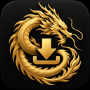

<div align="center">
  
  <h1>Dragon Download Manager</h1>
  <p><strong>A C++ and Qt download manager by Brami Group</strong></p>
  <p>Black-and-gold dragon emblem with a dark interface and gold highlights.</p>
</div>

Dragon Download Manager is a download manager customized for Brami Group and inspired by [mobile-dragon.net](https://mobile-dragon.net/), with a gold Chinese dragon identity and browser integration.

## Features

- Queue and manage downloads from direct links, batches, and web pages.
- Integrate with supported browsers through WebExtensions.
- Download supported video and audio streams.
- Handle torrent and magnet downloads.
- Pause and resume jobs, organize files, and customize application preferences.

## Technology

- C++ with the Qt 6 framework.
- CMake build system.
- Cross-platform source inherited from ArrowDL.

## Build

Windows downloads are published on the [Releases page](https://github.com/ammarsh90/dragon-download-manager/releases). Choose the x64 installer or extract the portable ZIP and run `DragonDownloadManager.exe`.

The binaries are unsigned. The release includes `SHA256SUMS.txt` for checking downloaded files.

Install the dependencies required by the upstream project, then configure and build with CMake:

```sh
cmake -S . -B build -DCMAKE_BUILD_TYPE=Release
cmake --build build --config Release
```

The Windows release executable is named `DragonDownloadManager.exe`. Build dependencies include Qt 6.5.3, a compatible MinGW compiler, Boost, OpenSSL 3 and libtorrent-rasterbar. The Windows workflow in `.github/workflows/deployment.yml` builds the application and installer.

`tools/build_windows.ps1` reproduces the local build with dependencies in `.deps` and CMake/Ninja in `.build-tools` (see its parameters for alternate paths). It was used with Qt 6.5.3, MinGW 13.1, Boost 1.84 and OpenSSL 3.0.16.

## Branding and attribution

The application name, metadata, theme, and new Dragon Download Manager artwork are branded for Brami Group. The program is derived from ArrowDL by Sébastien Vavassori; original copyright notices and the GNU LGPL v3 license are retained. See [LICENSE.md](LICENSE.md) and [BRANDING_LICENSE.md](BRANDING_LICENSE.md).

The original ArrowDL logo source is retained in `src/resources/logo/ArrowDL.svg` with its separate artwork license. The application uses the custom Dragon Download Manager icon set instead.
